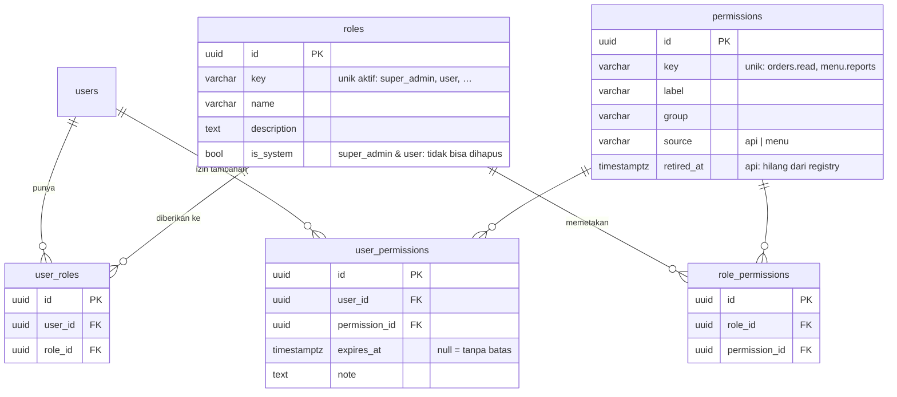

# Plan — RBAC dinamis (permission di database)

| Atribut | Nilai |
|---|---|
| Status | IN PROGRESS — plan disetujui 2026-11-06; Langkah 1 berikutnya |
| Tanggal | 2026-10-31 |
| Tujuan | Setiap proyek punya RBAC berbasis permission: permission dan pemetaannya di database (bisa diatur admin, termasuk menu), setiap route wajib menyebut permission-nya, siap ditambah tenancy tanpa mengubah API |

## Lanjut dari sini

**Posisi repo (2026-11-06)**: Langkah 0 di-commit di branch `docs/rbac-plan` (dari `main` = `origin/main` @ `b755c15`, rilis terakhir `v1.2.0`; belum di-push). Langkah 1 dikerjakan di `feat/rbac-schema`, bertumpuk di atas `docs/rbac-plan`.
**Sudah diputuskan — jangan tanya lagi**: D46–D61 (D46–D56 dulu R1–R11, D57–D61 dulu K1–K5), rancangan data E1–E4, keputusan terkait (tenancy, `feature:enable`, preset lite L1–L3, urutan).
**Masih terbuka**: F3 nama perintah sinkronisasi template — diputuskan di plan `feature:enable`.
**Berikutnya**: Langkah 1 (skema RBAC) → laporan → STOP untuk review.

## Konteks untuk sesi baru

- **Aturan user**: jawab dalam bahasa Indonesia; rekomendasikan lalu tanya; satu langkah per review lalu STOP; commit / push hanya atas permintaan; push **branch**, `main` lewat PR yang user *Rebase and merge*, lalu `git pull --ff-only`; tanpa baris atribusi di commit / PR; permintaan "nanti saja" langsung dicatat di plan atau `decisions.md` §3.
- **Mesin**: Linux, Postgres 16 + Redis 7 native (tanpa Docker). `docs-site/` punya `node_modules` sendiri (`cd docs-site && bun install` sekali sebelum `docs:build`).
- **Gate**: `bun run validate:full`, `build`, `docs:build`; `test:int` untuk repository / auth / migrasi / cache; `verify:scaffold` untuk template / CLI / API inti (sendiri, di background); `acceptance --combo a` untuk setup / CLI (lewat commit sementara `test/acceptance-wip`).
- **Kondisi kode sekarang (dicek 2026-11-06)**: `requireRole()` / `requireSelfOrRole()` di `src/core/middlewares/require-role.ts` (OpenAPI `x-allowed-callers`); `ROLES = ['admin', 'user']`, `DEFAULT_ROLE = 'user'` di `src/core/security/roles.ts`; role tersimpan di `users.role` (varchar) **dan di klaim JWT** (`src/core/security/jwt.ts:41`, `authenticate.ts:66`); dipakai di `users.routes.ts`, `partner-credentials.routes.ts`, DTO `users` / `auth`; modul contoh (`orders`, `projects` + dependent, `user-posts`) hanya memakai default-deny tanpa cek role. `seed:admin --promote` menjadikan user admin. Registrasi publik opsional (`registrationEnabled`).
- **Pola yang diikuti**: default-deny `PUBLIC_ROUTES` + enumerasi `app.routes` (D7, `src/app.ts`, `test/default-deny.e2e.test.ts`); `describeEndpoint()` (D35); `parentScope()` di `src/database/dependent.repository.ts` sebagai pola "satu titik penyaring"; audit `record_changes` lewat base repository (D16); UUID v7 + kolom audit dari `src/database/schema/columns.ts`; cache fail-open (`docs/standards/cache.md`, kunci di `src/core/cache/cache-keys.ts`); penanda pangkas `// partner:start|end` (R82); template scaffold di `.agents/skills/scaffold-module/`.
- **Pitfall alat**: edit dokumen pakai Edit / skrip Bun (heredoc Bash merusak `\n`); hook env memblokir perintah yang menyebut nama file env; server background — setelah TaskStop cek port (`ss -ltnp`) dan hentikan proses milik sendiri saja.

## Keputusan (disepakati user 2026-10-31)

| ID | Keputusan | Alasan |
|---|---|---|
| D46 (R1) | RBAC wajib untuk semua proyek; tidak ada mode "login tanpa role" | Akses yang terlupa = *broken access control*; satu jalur kode; biaya untuk aplikasi sederhana hampir nol (role super admin dari `setup`) |
| D47 (R2) | Permission = **aksi** (`products.read`, `.create`, `.update`, `.delete`, `.restore`), satu permission mencakup satu atau beberapa endpoint; daftar endpoint per permission **dibuat otomatis** dari route, deskripsi dari OpenAPI | Lebih stabil dari per-endpoint (path berubah, pemberian tetap); admin tidak mencentang dua kali untuk satu maksud |
| D48 (R3) | Permission disimpan di **database**: permission API berasal dari registry di kode dan disinkronkan ke database; permission **menu** dibuat bebas oleh admin; frontend membaca `GET /me/permissions` | Admin mengatur akses dan menu; permission API tanpa route yang memeriksanya tidak berarti apa-apa |
| D49 (R4) | Setiap route wajib menyebut permission (`requirePermission(...)`), route tanpa permission gagal di test; route untuk semua user yang login menyatakannya eksplisit (`allowAnyUser()`); aplikasi menolak start bila permission yang dipakai kode tidak ada di database | RBAC tidak bisa terlupa — perluasan default-deny D7 |
| D50 (R5) | Satu user boleh **beberapa role** | Mengurangi kebutuhan izin per user |
| D51 (R6) | Izin per user **hanya menambah** (awalnya kosong), masa berlaku opsional (`expires_at`) + catatan; **tanpa penolakan per user** | Sederhana dan mudah diaudit; kasus "kecuali si A" diselesaikan dengan role terpisah |
| D52 (R7) | Permission efektif = permission dari semua role aktif ∪ izin tambahan aktif dan belum kedaluwarsa; role **super admin** punya semua, tidak bisa diubah (anti terkunci) | Model role sebagai lapisan awal, user sebagai tambahan |
| D53 (R8) | Permission **tidak di JWT**; dibaca per request dari cache (kunci dari satu fungsi), cache dihapus saat role / pemetaan / izin berubah; setiap perubahan tercatat di audit trail | JWT 15 menit akan membuat perubahan akses terlambat |
| D54 (R9) | `bun run scaffold` membuat lima permission CRUD per modul; `bun run setup` membuat role super admin | Daftar permission selalu lengkap tanpa ditulis tangan |
| D55 (R10) | `user_roles (id, user_id, role_id, audit)` dan `user_permissions (id, user_id, permission_id, expires_at, note, audit)`: **`id` UUID v7 sendiri** (bukan PK gabungan), soft delete = pencabutan, unique hanya untuk baris aktif (`… WHERE deleted_at IS NULL`); tabel `permissions` (kunci unik + label + grup), `roles`, `role_permissions` | Menambah `tenant_id` nanti tidak mengubah PK, FK atau API |
| D56 (R11) | **Siap tenant tanpa kolom `tenant_id` sekarang**: semua query RBAC lewat satu titik penyaring di repository, kunci cache dari satu fungsi, tidak ada endpoint yang menerima tenant dari klien. Saat tenancy datang: `user_roles` / `user_permissions` + `tenant_id NOT NULL` (backfill ke tenant awal), `roles` + `tenant_id` NULL untuk role sistem, `permissions` / `role_permissions` tidak berubah | Kolom mati menyesatkan, tanpa FK, dan `NULL` di unique menjebak; struktur yang siap cukup satu migrasi tambahan |

## Keputusan pelengkap (disetujui user 2026-11-06)

Ditemukan saat menyusun langkah — celah yang belum dijawab D46–D56.

| ID | Keputusan | Alasan |
|---|---|---|
| D57 (K1) | Aturan "route wajib permission" (D49) berlaku untuk route **ber-JWT user**. Tiga kanal lain sudah punya penjaga sendiri dan dikecualikan secara eksplisit: `PUBLIC_ROUTES`, gateway partner (`partnerAuth()`), penerima webhook (verifikasi signature) | Partner dan vendor bukan user; memaksa permission di sana tidak berarti apa-apa. Test tetap memastikan setiap route masuk tepat satu kategori |
| D58 (K2) | Role **keluar dari JWT** dan kolom `users.role` dihapus: migrasi memindahkan `admin` → role `super_admin`, `user` → role `user` (di `user_roles`), lalu drop kolom. `ROLES` / `DEFAULT_ROLE` / `requireRole` / `requireSelfOrRole` dihapus; `requireSelfOrRole` diganti `requireSelfOrPermission` | Multi-role (D50) tidak muat di satu klaim; role di JWT membuat pencabutan terlambat 15 menit — alasan yang sama dengan D53. Token lama tetap valid (klaim lebih dibiarkan) |
| D59 (K3) | Role `user` adalah role sistem bawaan (bisa diubah pemetaannya, tidak bisa dihapus) yang otomatis diberikan saat registrasi publik / user dibuat tanpa role; awalnya tanpa permission (hanya route `allowAnyUser()`) | Perilaku registrasi sekarang tetap; aplikasi tetap aman bila admin belum mengatur apa pun |
| D60 (K4) | Permission di registry boleh punya **aksi di luar lima CRUD** (mis. `partner-credentials.rotate`); scaffold hanya membuat lima | `partner-credentials` sudah punya aksi rotate / suspend / revoke |
| D61 (K5) | Rilis **MAJOR (`v2.0.0`)** + panduan migrasi untuk proyek turunan (`requireRole` → `requirePermission`, migrasi `users.role`) | API publik inti berubah dan proyek turunan harus mengubah kode |

## Rancangan data (disetujui user 2026-11-06)

Setiap tabel juga memakai kolom standar: `timestamps()`, `auditColumns()`, `softDelete()` (`src/database/schema/columns.ts`). `users.role` dihapus di langkah 4 (K2).

| Tabel | Unique aktif (`activeUniqueIndex`) | Aturan |
|---|---|---|
| `roles` | `key` | `super_admin` tanpa baris `role_permissions`: "semua" dihitung di kode (D52), permission baru otomatis ikut |
| `permissions` | `key` | E1: `source = 'api'` dibuat sinkron registry, tidak bisa diubah / dihapus lewat API; `source = 'menu'` dibuat admin, kunci wajib berawalan `menu.` |
| `role_permissions` | `(role_id, permission_id)` | E2: `id` sendiri + soft delete seperti `user_roles` (audit `record_changes` per `id`, pencabutan tercatat) |
| `user_roles` | `(user_id, role_id)` | D55; soft delete = pencabutan |
| `user_permissions` | `(user_id, permission_id)` | D55; `expires_at` dicek saat menghitung dan membatasi TTL cache |

- **E3**: semua FK `ON DELETE RESTRICT` (soft delete di mana-mana; hard delete yang tidak sengaja ditolak database); index pada `user_id` dan `role_id` (permission per user, invalidasi per role).
- **E4**: permission API yang hilang dari registry tidak dihapus — sinkron mengisi `retired_at` (tidak lagi dihitung), kunci yang kembali mengosongkannya.
- **Permission efektif** (D52): `super_admin` aktif → semua permission `retired_at IS NULL`; selain itu permission dari `role_permissions` semua `user_roles` aktif ∪ `user_permissions` aktif dengan `expires_at IS NULL OR expires_at > now()`, keduanya hanya yang `retired_at IS NULL`.
- **Saat tenancy** (D56): `user_roles` / `user_permissions` + `tenant_id NOT NULL` (unique ikut `tenant_id`), `roles` + `tenant_id` NULL untuk role sistem; `permissions` / `role_permissions` tetap.

## Keputusan terkait (di luar plan ini)

- **Multi-tenancy** — plan sendiri, sesudah `feature:enable`; arah di `docs/decisions.md` §3: `tenant_id` + RLS berlapis, role per tenant, dipilih saat `setup`, `feature:enable tenancy` menulis migrasi backfill.
- **`feature:enable <fitur>`** (bukan `partner:enable`) + sinkronisasi template di mesin yang sama — `docs/decisions.md` §3; rujukan: template NestJS `~/Work/LNSW/lnsw-backend-template-nest` (`scripts/feature-enable.ts`, `scripts/upgrade-template.ts`, `scripts/upgrade/features.ts`, ADR 0014). F3 (nama perintah) diputuskan di plan itu.
- **Preset lite** — `docs/decisions.md` §3 (disepakati 2026-11-06): L1 satu repo, `bun run setup --preset lite` di mesin pangkas D39; L2 tetap berisi lapisan, kontrak HTTP, auth, **RBAC**, audit, cache, semua gate; L3 membuang `partner`, `webhook`, `integration` beserta pendukungnya, **semua varian `module` tetap** (standalone, record, header-detail, dependent).
- **Urutan**: (1) RBAC dinamis (plan ini) → (2) `feature:enable` + sinkronisasi template → (3) multi-tenancy → (4) preset lite.

## Langkah

| # | Langkah | Branch | Status | Commit |
|---|---|---|---|---|
| 0 | Plan ini + backlog `decisions.md` | `docs/rbac-plan` | ✅ | (lihat git log) |
| 1 | Skema RBAC, migrasi data `users.role`, seed role sistem | `feat/rbac-schema` | ⬜ |  |
| 2 | Registry permission, sinkron ke database, cek saat start | `feat/rbac-registry` | ⬜ |  |
| 3 | Repository RBAC, permission efektif, cache + invalidasi | `feat/rbac-resolver` | ⬜ |  |
| 4 | `requirePermission` / `allowAnyUser`, migrasi semua route, role keluar dari JWT | `feat/rbac-guards` | ⬜ |  |
| 5 | Rule "route wajib permission" + chaos test | `feat/rbac-rule` | ⬜ |  |
| 6 | API admin RBAC + `GET /me/permissions` + daftar endpoint per permission | `feat/rbac-admin-api` | ⬜ |  |
| 7 | Scaffold, `setup`, `seed:admin` | `feat/rbac-scaffold` | ⬜ |  |
| 8 | Dokumen, panduan migrasi, penutupan plan, rilis `v2.0.0` | `docs/rbac-close` | ⬜ |  |

Legenda: ⬜ belum · 🔄 dikerjakan · 👀 menunggu review · ✅ selesai · ⏸ ditunda

Langkah 1–4 mengubah kontrak secara bertahap; `main` tetap hijau di setiap langkah (langkah 1–3 menambah tanpa mencabut, `requireRole` baru dihapus di langkah 4).

### Langkah 1 — Skema RBAC, migrasi data, seed role sistem

**Langkah**: schema `permissions`, `roles`, `role_permissions`, `user_roles`, `user_permissions` di `src/database/schema/domain/` sesuai **Rancangan data** (D55, E1–E3); `roles.is_system` untuk `super_admin` dan `user` (K3). Migrasi: tabel + seed dua role sistem + salin `users.role` ke `user_roles` (K2). Kolom `users.role` **belum** di-drop (langkah 4).

**Selesai bila**:
- [ ] Migrasi naik di database kosong dan di database berisi user `admin` / `user`; setiap user lama punya tepat satu baris `user_roles` yang cocok (test integrasi)
- [ ] Unique parsial terbukti: penugasan ganda yang aktif ditolak, menugaskan ulang setelah dicabut diterima
- [ ] `test:int` + gate hijau; `docs/standards/database.md` mencatat tabel RBAC bila ada aturan baru

### Langkah 2 — Registry permission, sinkron, cek saat start

**Langkah**: registry di kode (satu file per modul, mis. `<module>.permissions.ts`, kunci `<module>.<aksi>`, label + grup; aksi tambahan K4) dikumpulkan di satu daftar; sinkron ke tabel `permissions` (tambah / perbarui label; permission API yang hilang dari kode diberi `retired_at` (E4), tidak dihapus; permission menu tidak disentuh) — dijalankan bersama `migrate` dan tersedia sebagai perintah; aplikasi menolak start bila ada permission di registry yang tidak ada di database (D49). Registry modul yang ada: `users`, `partner-credentials` (di dalam penanda partner), `orders`, `projects` + dependent, `user-posts`.

**Selesai bila**:
- [ ] Sinkron idempoten (dua kali → tanpa perubahan) dan tidak menyentuh permission menu (test integrasi)
- [ ] Start dengan permission yang belum disinkron gagal dengan pesan yang menyebut kuncinya
- [ ] Perintah baru terdaftar di `bun run help` + `--help` (R83); `setup` memangkas registry partner (`--no-partner`)
- [ ] Gate + `test:int` hijau

### Langkah 3 — Repository RBAC, permission efektif, cache

**Langkah**: repository RBAC dengan **satu titik penyaring** (D56, pola `parentScope()`); service yang menghitung permission efektif (D52: role aktif ∪ izin aktif belum kedaluwarsa; `super_admin` = semua); cache per user lewat `CACHE_KEYS` (satu fungsi kunci, fail-open sesuai `cache.md`, TTL dibatasi oleh `expires_at` terdekat); invalidasi saat role / pemetaan / izin berubah; perubahan tercatat di `record_changes` (D53).

**Selesai bila**:
- [ ] Test integrasi: multi-role, izin tambahan, kedaluwarsa, pencabutan (soft delete), super admin, Redis mati (fail-open ke database)
- [ ] Setiap perubahan menghapus cache user yang terdampak (termasuk perubahan pemetaan role → semua pemegang role itu)
- [ ] Gate + `test:int` hijau

### Langkah 4 — Guard, migrasi route, role keluar dari JWT

**Langkah**: `requirePermission(...)`, `allowAnyUser()`, `requireSelfOrPermission(param, ...)` di `src/core/middlewares/` (403 `ERR_PERMISSION_FORBIDDEN` terdokumentasi di OpenAPI, ekstensi menyebut permission-nya); semua route ber-JWT memakainya (`users`, `auth` (`/me`, logout…), `partner-credentials`, `orders`, `projects` + dependent, `user-posts`); hapus `requireRole`, `requireSelfOrRole`, `ROLES`, `DEFAULT_ROLE`, klaim `role` di JWT dan field `role` di DTO `users` / `auth` (K2) — diganti `roles: string[]` di respons user bila perlu; migrasi drop `users.role`. `scripts/lib/api-contract/flatten.ts` membaca ekstensi baru.

**Selesai bila**:
- [ ] Test e2e: tanpa permission → 403, dengan permission dari role / izin tambahan → 200, pencabutan berlaku di request berikutnya (tanpa login ulang)
- [ ] Token lama yang masih membawa `role` tetap diterima
- [ ] `git grep requireRole` kosong di `src/`; `openapi:check` menunjukkan perubahan kontrak yang diharapkan (snapshot diperbarui developer dengan `openapi:update`)
- [ ] Gate + `test:int` + `verify:scaffold` hijau (template ikut diubah seperlunya agar tetap lolos; template lengkap di langkah 7)

### Langkah 5 — Rule "route wajib permission"

**Langkah**: test enumerasi `app.routes` (pola `test/default-deny.e2e.test.ts`): setiap route harus tepat satu dari `requirePermission` / `allowAnyUser` / `PUBLIC_ROUTES` / kanal partner / kanal webhook (K1), dan setiap permission yang dipakai route ada di registry. Rule baru `R87` di `ARCHITECTURE.md` §12.

**Selesai bila**:
- [ ] Chaos test: hapus guard dari satu route → test gagal dengan pesan yang menyebut route-nya; pakai permission yang tidak terdaftar → gagal; pulihkan → hijau
- [ ] Gate hijau

### Langkah 6 — API admin RBAC + `/me/permissions`

**Langkah**: modul admin (nama modul diputuskan di langkah ini, mis. `roles` + `permissions`): CRUD role (role sistem tidak bisa dihapus, `super_admin` tidak bisa diubah), pemetaan role ↔ permission, CRUD permission **menu**, penugasan role ke user, izin tambahan per user (`expires_at`, `note`), daftar permission + endpoint yang dicakupnya (dari route + `describeEndpoint` / OpenAPI, D47); `GET /me/permissions` (`allowAnyUser()`). Semua endpoint admin dijaga permission-nya sendiri; tidak ada parameter tenant dari klien (D56).

**Selesai bila**:
- [ ] Test e2e untuk setiap endpoint, termasuk anti terkunci (tidak bisa mencabut `super_admin` terakhir, tidak bisa mengubah `super_admin`)
- [ ] Setiap perubahan memicu invalidasi cache + audit (dibuktikan test)
- [ ] Kontrak API terdokumentasi (`describeEndpoint`), `openapi:check` hijau setelah `openapi:update` oleh developer
- [ ] Gate + `test:int` hijau

### Langkah 7 — Scaffold, `setup`, `seed:admin`

**Langkah**: template scaffold (`.agents/skills/scaffold-module/` + referensinya) menghasilkan `<module>.permissions.ts` dengan lima permission CRUD (D54) dan `requirePermission` di setiap route — semua varian `module`, termasuk dependent (`--parent`, `--one`) dan header-detail; `partner` / `webhook` tidak (K1). `setup` dan `seed:admin` memberi role `super_admin` (`--promote` menugaskan role, bukan mengubah kolom); contoh yang dibuang `setup` ikut membuang registry permission-nya.

**Selesai bila**:
- [ ] `verify:scaffold` hijau untuk setiap varian (modul hasil scaffold lolos rule langkah 5)
- [ ] `acceptance --combo a` hijau (setup → admin bisa login dan memanggil endpoint admin RBAC)
- [ ] Gate hijau

### Langkah 8 — Dokumen, panduan migrasi, rilis

**Langkah**: standar `auth-and-inbound.md`, `database.md`, `http-contract.md`, `new-module.md`, `cache.md`; `ARCHITECTURE.md` §12; `docs/auth-guide.md` (menu dari `/me/permissions`); panduan migrasi proyek turunan (K5); README bila cara pakai berubah; `docs/decisions.md` (D46–D61), hapus plan; `update-version` → `v2.0.0` + CHANGELOG.

**Selesai bila**:
- [ ] `docs:build` (termasuk `check-links`) + gate hijau
- [ ] Plan dihapus di commit terakhir, keputusan ada di `decisions.md`

## Log

| Tanggal | Langkah | Catatan |
|---|---|---|
| 2026-10-31 | — | Draf dibuat saat handoff. Keputusan R1–R11 dari diskusi dengan user (RBAC wajib, permission aksi di database, menu, multi-role, izin per user hanya menambah, siap tenant). Diskusi juga menetapkan arah tenancy, `feature:enable`, lite dan urutan kerja (lihat Keputusan terkait) |
| 2026-11-06 | 0 | Branch `docs/rbac-plan`. R1–R11 diberi ID D46–D56. Preset lite dicatat di `decisions.md` §3 (L3 diputuskan: semua varian `module` tetap). Langkah 1–8 disusun dari pengecekan kode (role ada di JWT dan `users.role` → usulan K2); usulan K1–K5 menunggu persetujuan. Konteks diperbarui untuk Linux. Rancangan data (ERD) disetujui user dengan E1–E4 (`source` api/menu + awalan `menu.`, `role_permissions` ber-`id` + soft delete, FK `RESTRICT`, `retired_at`). Backlog tenancy di `decisions.md` §3 ditambah: wizard menjelaskan biaya pindah belakangan saat bertanya |
| 2026-11-06 | 0 | K1–K5 disetujui user → D57–D61; plan disetujui, Langkah 0 di-commit di `docs/rbac-plan`. Langkah 1 di `feat/rbac-schema`, bertumpuk di atas branch plan |
